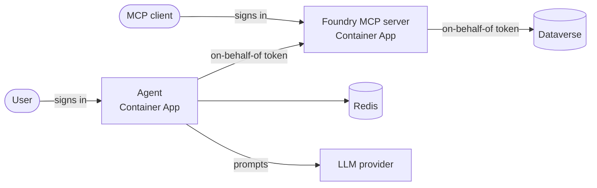

# Flowon Logic Fabric on Azure

[](https://github.com/flowon-official/logic-fabric-dataverse-azure/actions/workflows/validate.yml)

Bicep templates for deploying the Flowon Logic Fabric AI services for Microsoft Dataverse to
Azure Container Apps. The templates provision the Azure resources, the Microsoft Entra app
registrations and the Dataverse Application Users. Deploy them with the
[Azure Developer CLI](https://learn.microsoft.com/azure/developer/azure-developer-cli/) (`azd`)
or the Azure CLI.

| Template | Deploys |
|---|---|
| [`foundry`](foundry) | The Foundry MCP server plus the Assist, Assurance, Context, Guard, Insight and Sentinel agents (choose which), with on-behalf-of sign-in from each agent through Foundry to Dataverse |
| [`conductor`](conductor) | The Conductor MCP server on its own, exposing Logic Blocks, Logic Flows and business processes as MCP tools |

The two templates are independent: deploy either or both, into the same resource group or
separate ones.

## How it fits together



Every app authenticates as its own user-assigned managed identity through a federated
credential, so no client secret is created anywhere. Calls to Dataverse run as the signed-in
user, so each user's own Dataverse security roles apply.

## Before you start

You need:

- An Azure subscription where you can create resource groups and resources.
- Permission to create Entra app registrations (Application Administrator, Cloud Application
  Administrator or equivalent).
- Global Administrator or Privileged Role Administrator to grant admin consent for the Dataverse
  permission. Without it, deploy with `grantAdminConsent` set to `false` and have an administrator
  grant consent in the Entra admin center afterwards.
- A Dataverse environment with the **LogicFabricComposer** solution imported. It ships the
  **Logic Fabric Author** security role the templates assign.
- A setup managed identity with System Administrator in that Dataverse environment. Create it once
  per environment with [`scripts/New-DataverseSetupIdentity.ps1`](scripts/New-DataverseSetupIdentity.ps1).
- The latest [`azd`](https://aka.ms/azd-install), or the Azure CLI with the latest Bicep (`az bicep upgrade`). The templates use recent Bicep features and Azure Verified Modules.

Then follow the README of the template you want to deploy.

## Versions

Releases are tagged `vMAJOR.MINOR.PATCH` and described in the [changelog](CHANGELOG.md). Deploy
from a release tag rather than `main`.

The container images are versioned separately on Docker Hub (`flowon/logic-fabric-dataverse-*`).
Each template pins an image tag through its `imageTag` parameter, so redeploying never upgrades
your apps by surprise. To upgrade, set a newer `imageTag` and provision again.

## Repository layout

```
foundry/      Foundry and agents template (azd project)
conductor/    Conductor template (azd project)
modules/      Bicep modules shared by both templates
scripts/      Setup helpers
```

## Validating changes

```bash
az bicep build --file foundry/infra/main.bicep
az bicep build --file conductor/infra/main.bicep
```

Pull requests also run the Bicep linter and [PSRule for Azure](https://azure.github.io/PSRule.Rules.Azure/)
(configured in [`ps-rule.yaml`](ps-rule.yaml)).

## Support and security

- Product documentation: [docs.flowon.com](https://docs.flowon.com)
- Template bugs: [open an issue](https://github.com/flowon-official/logic-fabric-dataverse-azure/issues)
- Vulnerabilities: see [SECURITY.md](SECURITY.md)

## License

[MIT](LICENSE). Portions are derived from
[Azure-Samples/azmcp-obo-template](https://github.com/Azure-Samples/azmcp-obo-template); see
[NOTICE.md](NOTICE.md).
